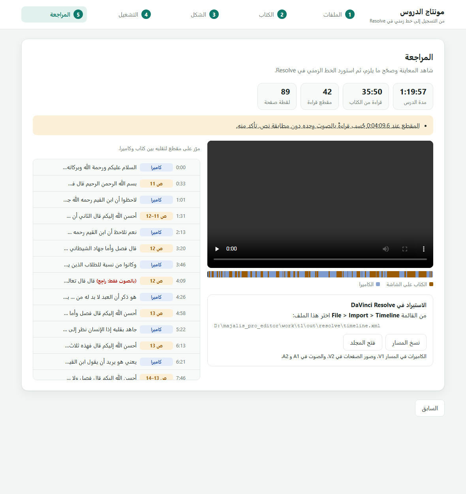
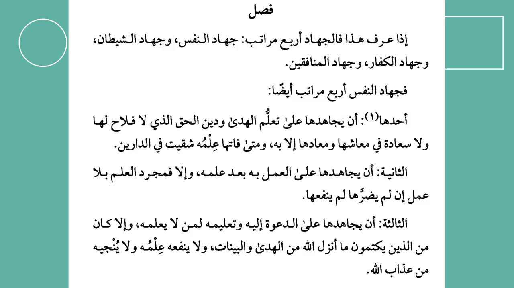

# majlis-cut: مونتاج أولي آلي لدروس قراءة الكتب

في دروس القراءة والتعليق يقرأ القارئ من الكتاب ويعلّق الشيخ، والفيديو النهائي يعرض **صفحة الكتاب حين يقرأ القارئ** و**الكاميرا حين يعلّق الشيخ**. هذه الأداة تصنع هذا التبديل آليًّا: تأخذ تسجيل الدرس وملف الكتاب، وتُخرج خطًّا زمنيًّا قابلًا للتعديل يُفتح في DaVinci Resolve (النسخة المجانية).

[**تنزيل آخر إصدار**](https://github.com/hamza-nahhas/majlis-cut/releases/latest) · [دليل الاستعمال](docs/USAGE.md) · [سجل التغييرات](CHANGELOG.md)



## ما تفعله

- تميّز القراءة من التعليق بمطابقة كلام التسجيل مع نص الكتاب، وتستعين بصوت القارئ فيما لا يحسمه النص.
- تعرض الصفحة التي يُقرأ منها، نصف صفحة تقريبًا في كل مرة، وتنتقل مع القارئ.
- تضع الصفحة بطاقةً على خلفية تصميمكم، أو على خلفية شفافة تظهر الكاميرا من تحتها. ويمكن إزالة ورق الصفحة ليبقى النص وحده.
- تزامن مقاطع الكاميرا (الأساسية والاحتياط) مع الصوت الرئيسي وتملأ الفجوات.
- تعمل مع فيديو جاهز أيضًا: تضيف إليه صفحات الكتاب فقط.
- نص الكتاب من [turath.io](https://app.turath.io)، أو يُقرأ من ملف الـPDF نفسه إن لم يكن الكتاب فيها.
- واجهة بخمس خطوات، مع مراجعة وتصحيح قبل الاستيراد.
- تتحدّث من واجهتها بنقرة واحدة.

كل المعالجة على جهازك. لا يُرفع التسجيل إلى أي خدمة (إلا إن اخترت التفريغ السحابي).



## التثبيت

1. من [صفحة الإصدارات](https://github.com/hamza-nahhas/majlis-cut/releases/latest) نزّل `majlis-cut-setup-vX.Y.Z.exe` (نحو 200 ميغابايت).
2. شغّله واضغط «التالي» حتى ينتهي. إن ظهرت رسالة «Windows protected your PC» فاضغط **More info** ثم **Run anyway**: البرنامج غير موقَّع بشهادة مدفوعة، ولا خطر فيه.
3. افتح الأداة من اختصار «مونتاج الدروس» على سطح المكتب أو في قائمة ابدأ. تُفتح الواجهة في المتصفح، وتبقى معها نافذة سوداء لا تُغلق أثناء العمل.

برنامج التثبيت يحمل Python والمكتبات و ffmpeg، فلا يلزم تثبيت شيء آخر. يُثبَّت للمستخدم الحالي بلا صلاحيات المدير، ويُزال من إعدادات ويندوز ← التطبيقات. في أول درس يُنزَّل نموذج التفريغ (نحو 1.6 غيغابايت) مرة واحدة.

التفاصيل، والتثبيت من الملف المضغوط أو بـgit، في [دليل التثبيت](docs/INSTALL.md).

### المتطلبات

| | |
|---|---|
| النظام | ويندوز 10 أو 11، 64 بت |
| الذاكرة | 8 غيغابايت أو أكثر (جُرّبت على 16) |
| المساحة | نحو 3 غيغابايت: الأداة (نحو 900 ميغابايت) ونموذج التفريغ |
| الإنترنت | للتثبيت، ولنص الكتاب من turath.io، ولنموذج التفريغ أول مرة |
| اللغة العربية في ويندوز | للكتب التي لا نص لها في turath.io فقط ([كيف تُضاف](docs/INSTALL.md#اللغة-العربية-لقراءة-الصفحات)) |
| DaVinci Resolve | لفتح الخط الزمني (المجانية تكفي) |

## التحديث

عند فتح الواجهة تسأل GitHub هل صدر إصدار أحدث. إن صدر ظهر شريط في أعلاها فيه «ما الجديد» وزر **حدِّث الآن**. نقرة واحدة تنزّله وتتحقق من بصمته وتثبّته، ثم تُفتح الواجهة من جديد. لا تُمسّ ملفاتكم ولا اختياراتكم ولا مجلدات الدروس، وإن فشل شيء أُعيدت النسخة القديمة كما كانت. التفاصيل في [التثبيت](docs/INSTALL.md#التحديث).

## الاستعمال

1. **الملفات:** تسجيل الدرس، ومقاطع الكاميرا إن وُجدت.
2. **الكتاب:** ملف الـPDF، والكتاب والمجلد من مكتبة تراث (أو قراءة النص من الـPDF).
3. **الشكل:** الخلفية (اختيارية)، وإزالة الورق، وحجم الصفحة وموضعها، بمعاينة حيّة.
4. **التشغيل.**
5. **المراجعة:** صحّح ما يلزم، ثم في Resolve: File ← Import ← Timeline ← `resolve\timeline.xml`.

الشرح الكامل، وسطر الأوامر، في [دليل الاستعمال](docs/USAGE.md).

### المخرجات

```
<مجلد الدرس>\
  resolve\   timeline.xml وصور الصفحات والصوت: كل ما يحتاجه Resolve
  review\    preview.mp4 للمعاينة السريعة، و report.txt
  work\      التفريغ والخطة والتصحيحات
```

في Resolve: الكاميرات في V1، وصور الصفحات في V2، والصوت في A1 و A2. صور الصفحات PNG بمقاس 1920×1080، شفافة حيث لا خلفية.

## التوثيق

| | |
|---|---|
| [التثبيت](docs/INSTALL.md) | برنامج التثبيت، والتثبيت اليدوي، والتحديث، واللغة العربية |
| [دليل الاستعمال](docs/USAGE.md) | الخطوات بالتفصيل، التصحيح، الاستيراد في Resolve، سطر الأوامر |
| [كيف تعمل](docs/HOW_IT_WORKS.md) | المراحل والخوارزميات وبنية الشيفرة وصيغ الملفات والإصدار |
| [حل المشكلات](docs/TROUBLESHOOTING.md) | الملاحظات ومعانيها، وأعطال التشغيل و Resolve |
| [سجل التغييرات](CHANGELOG.md) | ما الجديد في كل إصدار |

## للمطورين

### التشغيل من المصدر

يلزم Python 3.11 أو أحدث (جُرّبت على 3.13)، و ffmpeg في مسار النظام.

```powershell
git clone https://github.com/hamza-nahhas/majlis-cut.git
cd majlis-cut
.\setup.bat     # مرة واحدة: بيئة .venv والمكتبات
.\start.bat     # الواجهة
```

أو من سطر الأوامر بلا واجهة:

```powershell
.venv\Scripts\python.exe -m majlis_cut --audio lesson.mp3 --pdf book.pdf --turath 197 --vol 3 --out D:\lessons\lesson1
```

`start.bat` يثبّت المكتبات من جديد كلما تغيّر `requirements.txt` (عبر `majlis_cut/deps.py`)، فلا حاجة لإعادة `setup.bat`. المكتبات فيه بحدود مجرَّبة، والإصدارات التي جُرّبت مكتوبة بجانبها.

### بنية المشروع

```
majlis_cut\        الأداة: المراحل في __main__.py، والواجهة في ui.py و ui.html،
                   والتحديث في update.py (التفاصيل في docs\HOW_IT_WORKS.md)
tests\             test_fill و test_update و test_paper تعمل وحدها؛ الباقي يحتاج ملفات دروس
tools\             build_installer.ps1، release_notes.py، make_icon.py
installer\         majlis-cut.iss: نص برنامج التثبيت (Inno Setup 7)
.github\workflows\ release.yml: بناء الإصدار ونشره
setup.bat          تهيئة نسخة المصدر
start.bat          التشغيل، وإعادة الفتح بعد التحديث
```

### الاختبارات

```powershell
.venv\Scripts\python.exe tests\test_fill.py      # ملء الأماكن الفارغة بصفحة الكتاب
.venv\Scripts\python.exe tests\test_update.py    # المحدِّث: المقارنة والتثبيت والرفض
.venv\Scripts\python.exe tests\test_paper.py     # إزالة ورق الصفحة
.venv\Scripts\python.exe tests\check_ui_js.py    # سلامة شيفرة الواجهة (يحتاج node)
```

### بناء برنامج التثبيت

يلزم git، و [uv](https://docs.astral.sh/uv/)، و [Inno Setup 7](https://jrsoftware.org/isinfo.php).

```powershell
powershell -ExecutionPolicy Bypass -File tools\build_installer.ps1 -Iscc "<مسار ISCC.exe>"
```

يحزم آخر commit (لا التعديلات غير المحفوظة)، ومعه Python 3.13 مستقل والمكتبات مثبّتة فيه، و ffmpeg و ffprobe من أحدث فرع مستقر. الناتج `build\majlis-cut-setup-vX.Y.Z.exe`. يستغرق نحو 10 دقائق، أكثرها في الضغط.

### إصدار نسخة جديدة

1. ارفع الرقم في `majlis_cut/__init__.py` (`__version__`)، وهو المكان الوحيد للرقم.
2. أضف قسمًا `## X.Y.Z - التاريخ` أعلى `CHANGELOG.md`. نصّه هو ما يراه المستخدم في شريط التحديث.
3. ادمج في `master`، ثم:
   ```powershell
   git tag vX.Y.Z
   git push origin vX.Y.Z
   ```
4. يتحقق مسار الإصدار في GitHub من تطابق الوسم والرقم، ويشغّل الاختبارات، ويبني الملف المضغوط (للتحديث) وبرنامج التثبيت (للمستخدمين الجدد)، وينشرهما. يستغرق نحو 6 دقائق.

بعدها يرى كل من فتح الأداة شريط التحديث. لا تكتب في `start.bat` أسطرًا تُنفَّذ بعد تشغيل الواجهة خارج كتلته، ولا تغيّر صيغة الذاكرة المؤقتة دون أن يُكشف التغيير (كما يفعل `VIEW_VERSION`). السبب في [كيف تعمل](docs/HOW_IT_WORKS.md#الإصدار-والتحديث).

## الحالة

الأداة تعمل من أولها إلى آخرها على درسين حقيقيين، واستيرادها في Resolve مجرَّب، وبرنامج التثبيت والتحديث من GitHub مجرَّبان على جهاز نظيف. الذي لم يُجرَّب بعد: مقاطع كاميرا حقيقية (المزامنة مجرَّبة على مقاطع مُحاكاة فقط)، واستيراد الصور الشفافة في Resolve، والتفريغ السحابي، وقراءة الـPDF على كتب رديئة التصوير. التفاصيل في [كيف تعمل](docs/HOW_IT_WORKS.md#ما-اختُبر-وما-لم-يُختبر).

## الأدوات المستعملة

faster-whisper (التفريغ)، PyMuPDF (الصفحات)، قارئ ويندوز المدمج (قراءة النص من الصور)، numpy و scipy (المطابقة والصوت والمزامنة)، ffmpeg (الصوت والفيديو)، Inno Setup و python-build-standalone (برنامج التثبيت).

## الترخيص

الأداة بترخيص [MIT](LICENSE). برنامج التثبيت يحمل معه ffmpeg من بنايات [BtbN](https://github.com/BtbN/FFmpeg-Builds) بترخيص GPL، وترخيصه ومصدره في مجلد `ffmpeg` داخل مجلد التثبيت.
